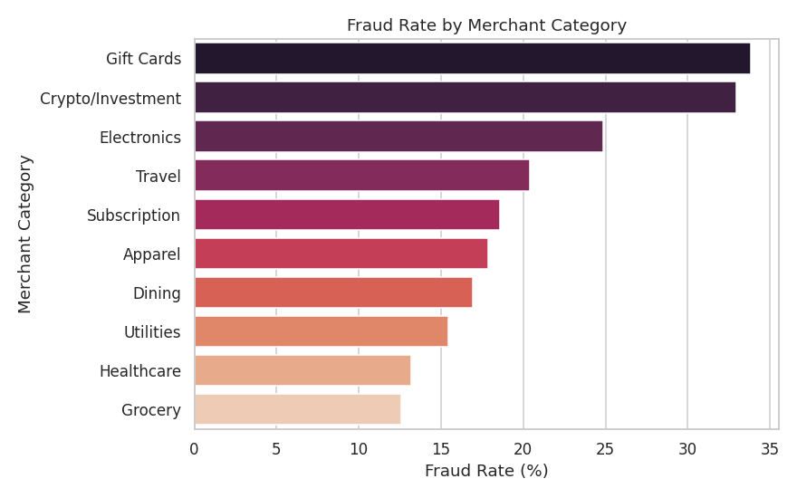
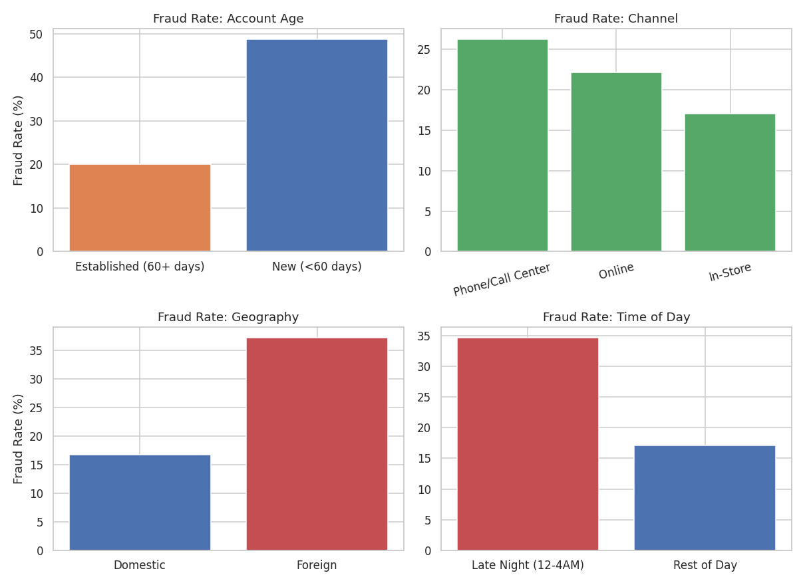
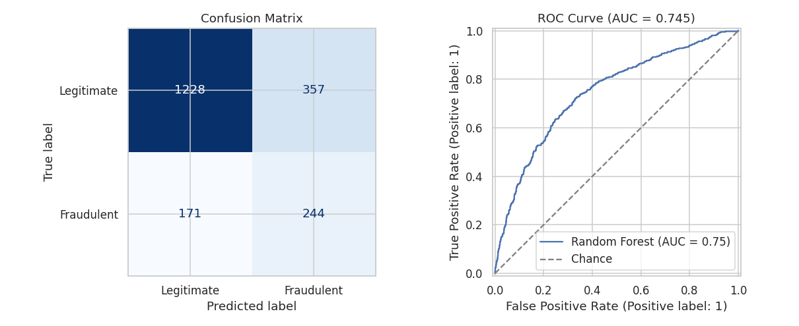
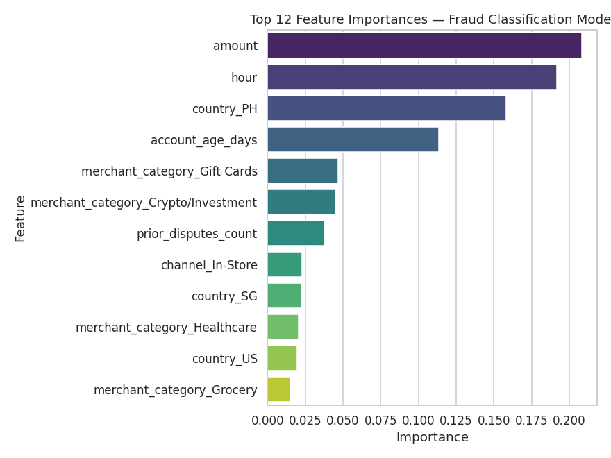

# Fraud & Dispute Detection Analysis

A SQL + Python project that analyzes disputed financial transactions — each
reviewed and categorized as **Fraudulent** or **Legitimate** — to uncover the
patterns that make a transaction likely to be fraudulent, and to build a
model that flags high-risk disputes for review.

This project is inspired by real dispute-review work: monthly, transactions
flagged by customers or systems get manually assessed and categorized as
fraudulent or legitimate. Here, that workflow is rebuilt end-to-end — from
raw data, to SQL exploration, to a trained classification model — as a
portfolio piece.

> **Data note:** The dataset (`data/transactions.csv`) is **synthetically
> generated** (see `src/generate_data.py`) to resemble realistic fraud
> patterns. No real customer, company, or financial data is used anywhere
> in this project.

---

## Why this project

Fraud/dispute review isn't just "look at a transaction and guess" — it's
pattern recognition across account history, merchant type, timing, and
geography, and it benefits from being backed by data rather than gut feel.
This project demonstrates that full pipeline:

1. **SQL** — explore the raw disputes with real analytical queries (fraud
   rate by category, channel, geography, account age, time of day, repeat
   offenders).
2. **Python (pandas)** — deeper exploration and visualization of the same
   patterns.
3. **Machine Learning (scikit-learn)** — a Random Forest model that predicts
   whether a *new* dispute is likely fraudulent, so a review team could
   prioritize the riskiest cases first instead of working the queue in
   arrival order.

---

## Key findings

- **Overall fraud rate** among reviewed disputes: **20.75%**
- **New accounts** (under 60 days old) had a fraud rate of **48.7%**, vs.
  **20.1%** for established accounts — more than **2x** the risk.
- **Foreign transactions** had a fraud rate of **37.2%**, vs. **16.7%** for
  domestic transactions.
- **Gift Cards** (33.9%) and **Crypto/Investment** (33.0%) were the riskiest
  merchant categories — consistent with real-world fraud trends, since both
  are fast, hard-to-reverse cash-out methods.
- A **Random Forest classifier** trained on these features reached an
  **ROC-AUC of 0.75**, correctly recalling **59% of fraudulent disputes**
  in the test set while keeping the model simple and interpretable.

| Segment | Fraud Rate |
|---|---|
| New account (<60 days) | 48.7% |
| Foreign transaction | 37.2% |
| Gift Cards | 33.9% |
| Crypto/Investment | 33.0% |
| Domestic transaction | 16.7% |
| Established account (60+ days) | 20.1% |

### Visuals

**Fraud rate by merchant category**


**Risk factors: account age, channel, geography, time of day**


**Model evaluation: confusion matrix & ROC curve**


**What drives the model's predictions**


See the full notebook — [`notebooks/fraud_analysis.ipynb`](notebooks/fraud_analysis.ipynb) —
for the complete analysis with all charts and commentary.

---

## Repository structure

```
fraud-dispute-detection/
├── data/
│   └── transactions.csv          # synthetic dataset (8,000 disputed transactions)
├── sql/
│   ├── schema.sql                # table definition
│   └── analysis_queries.sql      # 10 analytical SQL queries
├── notebooks/
│   └── fraud_analysis.ipynb      # full EDA + modeling notebook (with outputs)
├── src/
│   ├── generate_data.py          # generates the synthetic dataset
│   └── build_database.py         # loads CSV into SQLite & runs all SQL queries
├── images/                       # chart exports used in this README
├── requirements.txt
└── README.md
```

---

## How to run this yourself

```bash
# 1. Clone the repo
git clone https://github.com/<your-username>/fraud-dispute-detection.git
cd fraud-dispute-detection

# 2. Install dependencies
pip install -r requirements.txt

# 3. (Re)generate the synthetic dataset
python src/generate_data.py

# 4. Load it into SQLite and run the analytical SQL queries
python src/build_database.py

# 5. Open the notebook to see the full analysis and model
jupyter notebook notebooks/fraud_analysis.ipynb
```

You can also explore `sql/analysis_queries.sql` directly against
`data/fraud_disputes.db` using any SQLite client (e.g., DB Browser for
SQLite, or the `sqlite3` CLI: `sqlite3 data/fraud_disputes.db`).

---

## Tech stack

- **Python**: pandas, numpy, scikit-learn, matplotlib, seaborn
- **SQL**: SQLite
- **Modeling**: Random Forest Classifier (scikit-learn), evaluated with
  precision/recall/F1, confusion matrix, and ROC-AUC

---

## Dataset details

The synthetic dataset models 8,000 disputed transactions with the following
fields:

| Column | Description |
|---|---|
| `transaction_id` | Unique transaction identifier |
| `customer_id` | Customer identifier (some customers repeat) |
| `transaction_datetime` | Timestamp of the transaction |
| `amount` | Transaction amount |
| `merchant_category` | e.g., Grocery, Electronics, Gift Cards, Crypto/Investment |
| `channel` | Online / In-Store / Phone-Call Center |
| `country` | Transaction country (domestic = PH) |
| `account_age_days` | How old the customer's account was at time of transaction |
| `prior_disputes_count` | Number of prior disputes filed by this customer |
| `is_fraud` | 1 = confirmed fraudulent, 0 = legitimate |
| `dispute_status` | Human-readable label: "Fraudulent" / "Legitimate" |

Fraud probability was generated using a logistic model combining merchant
category, channel, transaction amount, account age, geography, time of day,
and prior dispute history — so the patterns explored in this project mirror
genuine, learnable fraud signals rather than random noise.

---

## Future improvements

- Add a cost-sensitive threshold tuning step (false negatives — missed
  fraud — are typically more costly than false positives in real fraud
  review).
- Compare Random Forest against a simpler baseline (logistic regression)
  and a gradient-boosted model (XGBoost/LightGBM).
- Build a lightweight Streamlit dashboard for interactively exploring the
  SQL query results.

---

## Author

**Honey Flores** — [LinkedIn](https://www.linkedin.com/in/honey-flores-ai4037/) · [Email](mailto:floreshoneyt@gmail.com)
